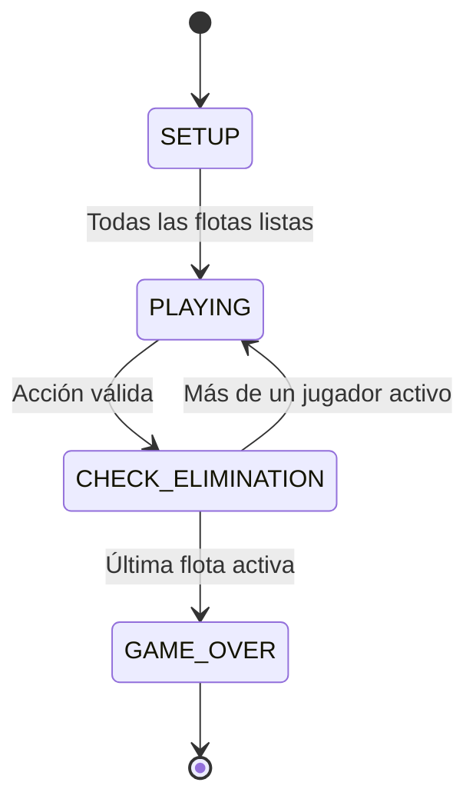

# Flota táctica

Juego de estrategia naval por turnos en **HTML5 Canvas + TypeScript**. Permite de 2 a 4 jugadores: un humano contra IAs, varios humanos en **Pass & Play**, o grupos mixtos. Cada participante tiene una flota y un tablero independiente.

## Jugar desde la web o descargar Windows

El despliegue está preparado para el repositorio actual [JDaza69/JUEGO-battleship-COMUN](https://github.com/JDaza69/JUEGO-battleship-COMUN).

- **Web:** la dirección prevista de GitHub Pages es `https://jdaza69.github.io/JUEGO-battleship-COMUN/`. Este enlace solo estará disponible después de activar Pages y completar la publicación.
- **Windows x64:** el flujo de versiones publica `Flota-Tactica-1.1.0-Windows.exe` y `SHA256SUMS.txt` en [GitHub Releases](https://github.com/JDaza69/JUEGO-battleship-COMUN/releases). La descarga aparece después de que termine correctamente el flujo de Windows.

El `.exe` es una aplicación portable: no requiere Node.js, servidor ni instalación. Guarda el archivo en una carpeta y ábrelo. Incluye todos los recursos y funciona sin conexión. Esta edición no tiene firma digital; Windows puede mostrar un aviso de editor desconocido. La edición web y el ejecutable comparten las mismas reglas y el mismo motor.

### Publicación web

1. En **Settings → Pages → Build and deployment → Source**, selecciona **GitHub Actions**. Esta activación es necesaria una sola vez y exige permisos de administración sobre el repositorio.
2. En **Actions → Publicar web**, pulsa **Run workflow**, o sube un cambio a `main`.
3. El flujo instala las dependencias con el lockfile, ejecuta las pruebas, compila, prueba la interfaz y la subruta de producción, y publica `dist/`.
4. Comprueba que el trabajo `deploy` haya terminado antes de compartir la dirección de Pages.

También se puede activar Pages desde una terminal autenticada con permisos suficientes:

```bash
node scripts/github-publish.mjs
```

No necesitas crear un token para los flujos: usan los permisos de GitHub Actions del propio repositorio. La autenticación de la terminal es independiente de la de los flujos.

### Publicar un ejecutable

El flujo **Publicar ejecutable Windows** se inicia al subir una etiqueta `v*` y compila en Windows. Antes de publicar la descarga, abre la aplicación empaquetada y comprueba menú, despliegue, combate, reconocimiento y un turno de IA. A continuación adjunta el `.exe` y su SHA-256 a GitHub Releases. No se guardan binarios ni `node_modules` en el historial del código.

Para futuras versiones, actualiza primero `version` en `package.json` y el lockfile; después crea una etiqueta con esa misma versión:

```bash
git tag v1.1.0
git push origin v1.1.0
```

No repitas esos comandos si la etiqueta ya existe. También puedes ejecutar el flujo manualmente: en ese caso, el `.exe` se conserva en **Actions → ejecución → Artifacts**, sin crear una nueva versión pública.

### Compilar escritorio localmente

```bash
npm ci
npm run desktop          # Compila y abre la aplicación Electron
npm run desktop:build    # Genera release/Flota-Tactica-1.1.0-Windows.exe
```

Se recomienda generar y probar la versión Windows en Windows x64. El flujo de GitHub lo hace automáticamente. En Linux se admite compilación cruzada del portable; ejecutarlo y probarlo requiere Windows. `npm run test:desktop` comprueba `release/win-unpacked/Flota Tactica.exe` en Windows, después de empaquetar.

## Ejecutar

Requisitos: **Node.js 22.12 o posterior** y npm (se probó con Node 24). No necesita backend, cuentas, claves ni servicios externos.

```bash
cd /workspace/LO-PRIMERO   # O la carpeta donde clonaste el proyecto
npm ci                   # Instalación reproducible con package-lock.json
npm run dev
```

Abre la dirección que indique Vite en el navegador (puerto predeterminado 5173). Para compilar y revisar la versión de producción:

```bash
npm run build
npm run preview
```

`dist/` contiene la web estática compilada. Puede alojarse en cualquier servidor de archivos estáticos. No carga fuentes, imágenes ni APIs externas; después de cargar el juego, todas las reglas se ejecutan localmente. La partida vive en memoria: recargar la página la reinicia.

## Cómo jugar

1. Selecciona uno de los cuatro mapas, el tamaño 10×10, 15×15 o 20×20, el total de participantes y cuántos son humanos. El resto son IAs fáciles o difíciles.
2. Cada humano despliega su flota haciendo clic en la primera casilla de cada barco. **R** cambia entre orientación horizontal y vertical. También puedes desplegar automáticamente o limpiar y recolocar toda la flota. Las IAs se colocan automáticamente.
3. En combate, elige un rival activo y un disparo o habilidad; pulsa una casilla del radar rival. El motor valida la acción antes de gastar el turno.
4. Revisa tu informe privado y pulsa **Finalizar turno**. En Pass & Play aparece una pantalla de relevo antes de mostrar el tablero del próximo humano. Los tableros anteriores se retiran del DOM.
5. Los jugadores eliminados se omiten en la rotación. Gana la última flota con al menos un segmento intacto.

Los tableros interactivos también aceptan **flechas + Enter o Espacio**. Los controles tienen foco visible y el diseño se adapta a móvil. Seleccionar una acción no la ejecuta hasta que se elija una casilla.

### Flota y habilidades

| Nave | Casillas | Habilidad | Recarga |
| --- | ---: | --- | ---: |
| Portaviones | 5 | Reconocimiento aéreo: revela 3×3 centrado en la casilla elegida, sin daño | 3 turnos propios |
| Acorazado | 4 | Gran calibre: ataca 2×2 desde la esquina superior izquierda elegida | 4 turnos propios |
| Submarino | 3 | Torpedo sigiloso: recorre una línea hasta la primera nave, roca o mina | 3 turnos propios |
| Crucero | 3 | Disparo normal | — |
| Destructor | 2 | Disparo normal | — |

Una acción, incluso reconocimiento, termina el turno. Usar una habilidad en el turno propio `t` bloquea los siguientes `N` turnos propios completos: vuelve a estar disponible en `t + N + 1`. Los turnos de otros jugadores no reducen la recarga. Las habilidades de naves hundidas quedan deshabilitadas.

El torpedo viaja **al este en H** o **al sur en V** desde la casilla seleccionada; se detiene también ante un segmento ya dañado. Las áreas 2×2 y 3×3 se recortan al borde. Gran calibre puede afectar casillas ya conocidas, pero no vuelve a dañar segmentos dañados. Un disparo normal no puede repetir una casilla conocida como HIT/MISS ni apuntar a una roca.

### Mapas

| Mapa | Regla |
| --- | --- |
| Mar abierto | Agua sin obstáculos |
| Archipiélago escondido | Rocas públicas: impiden colocar barcos, bloquean el disparo en esa casilla y detienen torpedos; no reciben daño |
| Estrecho de corales | Arrecifes públicos: permiten colocar barcos, pero cada segmento colocado encima empieza dañado |
| Campo de minas | Minas ocultas: no permiten colocar barcos; un disparo a la mina o a una casilla adyacente, incluso diagonal, detona una explosión 3×3; otras minas próximas a los impactos pueden encadenarse |

Cada tablero genera su terreno independientemente. Las primeras cinco filas están libres de terreno peligroso para garantizar espacio para toda la flota, incluso en 10×10. La colocación automática evita arrecifes; un humano puede asumir ese daño al colocar manualmente. No existe movimiento de naves durante el combate.

### Niebla de guerra e IA

`Cell.visibility` almacena la última información conocida por **cada observador**. El reconocimiento es una instantánea: no otorga visión continua ni revela datos a terceros. Cuando se hunde una nave, sus segmentos se revelan al atacante. El diario público omite coordenadas, impactos y resultados de reconocimiento.

- **Fácil:** elige casillas aleatorias válidas sin repetir, con memoria separada por rival.
- **Difícil:** después de un HIT, prioriza el mismo rival y busca N, S, E, O. Cada nuevo HIT amplía la frontera; al hundir una nave elimina su caza, conservando otras naves pendientes. Si agota la frontera, vuelve al ataque aleatorio.

Las IAs usan disparos simples; las habilidades tácticas están disponibles para los humanos. Las estrategias reciben únicamente `TargetView`, sin acceso a barcos ni minas ocultas. Se puede añadir una política de habilidades a `aiTurn()` sin modificar el renderer.

## Arquitectura

`desktop/main.cjs` contiene el contenedor Electron; `vite.config.ts` usa assets relativos para Pages y escritorio; los flujos de `.github/workflows/` separan la publicación de la web y la del portable de Windows. El renderer de escritorio no tiene acceso a Node.js y ejecuta el juego en un sandbox.

```text
src/
  domain/
    models.ts          GameConfig, Cell, Ship, contratos, flota y cooldowns
    terrain.ts         Generación de los cuatro mapas
    board.ts           Board: colocación, visibilidad, daño y habilidades
    player.ts          Player, HumanPlayer, AIPlayer
  ai/
    strategies.ts      EasyStrategy y HardStrategy implementan AttackStrategy
  application/
    state-machine.ts   Transiciones permitidas y sus guardas
    commands.ts        Command, AttackCommand, AbilityCommand, ActionReceiver
    game.ts            GameManager: turnos, validación, eliminación e historial
  ui/
    board-renderer.ts  Canvas y entrada de coordenadas, sin reglas de combate
  engine.ts            API pública del motor
  main.ts              Pantallas, eventos y relevo entre jugadores
  style.css            Diseño adaptable
```

El dominio y la aplicación no dependen del DOM, Canvas ni Vite. Se pueden reutilizar desde una CLI, otro renderer o un servidor autoritativo.

- **Responsabilidad única:** terreno genera geografía; Board resuelve reglas espaciales; GameManager coordina turnos; Canvas dibuja.
- **Strategy:** AIPlayer recibe una estrategia intercambiable mediante el contrato `AttackStrategy`.
- **Command:** la interfaz crea `AttackCommand` o `AbilityCommand`; el receptor valida y ejecuta. Un error no consume el turno. Los resultados se registran en `history`; el historial es de resultados, no un sistema de deshacer.
- **State Machine:** `GameStateMachine` impide transiciones ilegales y centraliza el flujo.
- **Interfaces pequeñas e inversión de dependencias:** las estrategias dependen de `TargetView`, los comandos de `ActionReceiver`; el azar puede inyectarse para pruebas reproducibles.



Ejemplo de uso sin interfaz:

```ts
import { GameManager, AttackCommand, AbilityCommand } from './src/engine';

const game = new GameManager({
  size: 15, theme: 'mines', players: 3, humans: 1, difficulty: 'hard',
});
for (const player of game.players) game.autoPlace(player.id);
game.start();
const report = game.execute(new AbilityCommand(1, { x: 4, y: 4 }, 'recon'));
// Avanza ahora la IA cuyo turno corresponda, o envía el siguiente comando humano.
// game.aiTurn();
// game.execute(new AttackCommand(targetId, { x: 5, y: 4 }));
```

Las APIs `Board.place_ship()`, `Board.is_valid_placement()`, `Board.receive_attack()` y `Board.apply_ability()` también pueden usarse para herramientas o pruebas. Para una partida normal conviene enviar acciones y despliegue a través de GameManager: esas operaciones verifican la fase y el rival.

## Validación

```bash
npm test                  # Reglas del motor y partidas completas reproducibles
npm run build             # TypeScript estricto + compilación web
npx playwright install chromium
npm run build             # Necesario para la prueba de producción
npm run test:ui           # Pruebas funcionales y build bajo la ruta de Pages
```

Si ya tienes Chromium instalado, evita otra descarga con:

```bash
npm run build
CHROMIUM_PATH=/usr/bin/chromium npm run test:ui
```

Las pruebas del motor incluyen configuraciones inválidas, colocación, salud, privacidad, arrecifes, cadenas de minas, límites, torpedos, caza de la IA, cooldowns, errores atómicos, eliminación y **72 partidas completas**: cuatro mapas × tres tamaños × tres cantidades de jugadores × dos dificultades. Las pruebas de navegador cubren el menú móvil, colocación manual/automática, informes privados, relevos turnos de IA y una partida Pass & Play hasta la victoria.

Pass & Play es privacidad visual en un dispositivo compartido, no una barrera frente a quien inspeccione la memoria del navegador. El multijugador por red y el guardado persistente quedan fuera del alcance de esta base local.
